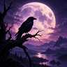

# v001 — Raven beneath the violet moon

**Recorded:** 2026-10-26  
**Type:** Generated illustration; raster original  
**Reception:** Explicitly liked as an artistic direction.  
**Canonical commercial emblem:** Not selected.

## Observed composition

A dark-feathered raven perched on a twisted foreground branch, silhouetted before an enormous pale-lavender moon. A deep purple dusk sky, softly lit clouds, distant ridges, forest and reflective water create depth. The scene is tranquil, otherworldly, and melancholic.

The raven's head and curved beak read clearly; moonlight serves as primary contrast. Peripheral scenery is optional when adapting for avatars or wordmarks.

## Identifying the exact source

Original filename: `raven_beneath_the_violet_moon.png`  
Format: PNG, RGB, 1254 × 1254  
SHA-256: `8a0e0d072a5f601366de6861976a060e52d96685ec4a129c8de4243fca7f8200`  
Generation date: 2026-10-26

The source file was verified in the working conversation. **This repository does not yet contain the PNG binary.** See [the import record](../../../../media-import.json). Never replace it with a new render while claiming it is the original.

## View first archived preview

The 96 × 96 JPEG is a faithful low-resolution preview. SHA-256: `5811975d16f62f56537fef9e3ddcf65b2d56866471e5a457d2ea3f361b3345ee`. Git blob: `6b63113389bf2b70adfad4717bd8f5080eb7d650`. The original 1254 × 1254 PNG is still external to this repository.

## Next authorized transformations

Derivative artwork may be cropped and resized for a social profile or banner with provenance intact. Simplified emblems, wordmarks and animations are separate design work, not completed v001 features.
