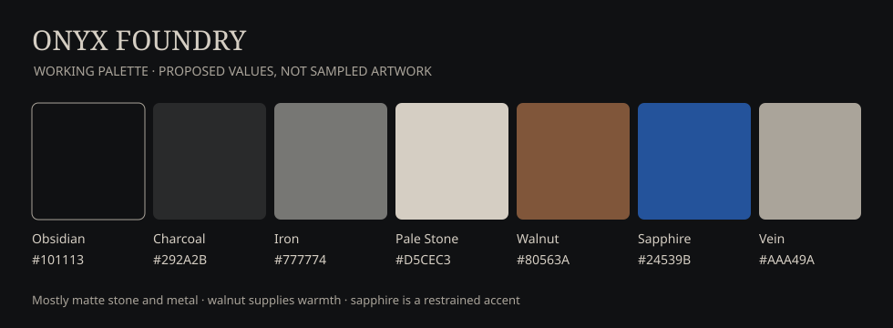

# Onyx Foundry — visual identity

**Palette reference:** [Structured color tokens](identity.yml) · **Typography:** [Berenis ADF Pro](typography.md) · **Experiments:** [Gallery and status](experiments/README.md)

## Fixed language (current working brief)

- **Mark:** One integrated OF symbol. The thick onyx ring reads as **O**; the wooden, obsidian-edged industrial construct reads as **F**.
- **Current F proposal:** carved walnut vertical shaft with a blunt base; steampunk metal barrel projecting right from the upper gear, smoking from the **right end**; metallic middle gear arm.
- **Surfaces:** mostly matte and tactile; blue light limited to small gem/crystal details except in intentionally animated variants.
- **Wordmark:** original, **unmodified Berenis ADF Pro** lettering. Avoid arbitrary notch/cut/distress modifications; solid matte Pale Stone works best.
- **Presentation:** visual variants may differ (32-bit, cinematic, industrial, fantasy, monochrome) while preserving studio identity.

## Chosen versus provisional

| Element | Decision |
| --- | --- |
| Brand name | Onyx Foundry, selected creative direction; clearance pending |
| Base typeface | Original Berenis ADF Pro; accepted without custom letter cuts |
| Core colors | Provisional numeric values; visually accepted family |
| Wood / obsidian / onyx / iron | Accepted material language |
| 32-bit animated presentation | Approved as a stylistic treatment |
| Barrel + top gear + middle gear emblem | Current preferred candidate; not final master |
| Legal rights and asset sources | To be reviewed before distribution |

## Presentation conventions

Keep each experiment's source, rendered exports, and preview together under its own version. The [experiment index](experiments/README.md) is the navigable gallery. Do not replace an approved pixel treatment when developing the physical/cinematic logo.

The palette image is a **new schematic swatch chart**, not an extraction from the generated artwork. Exact numerical colors are adjustable.
